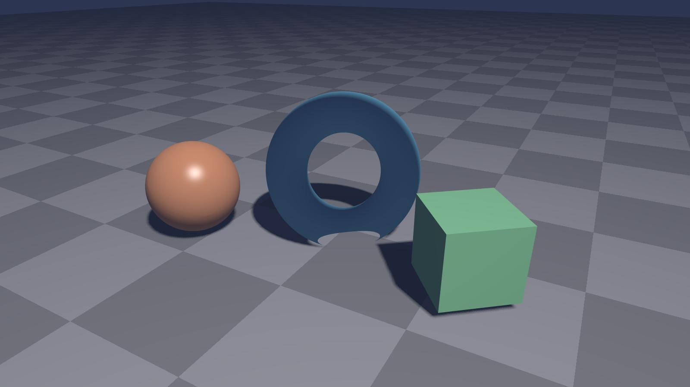
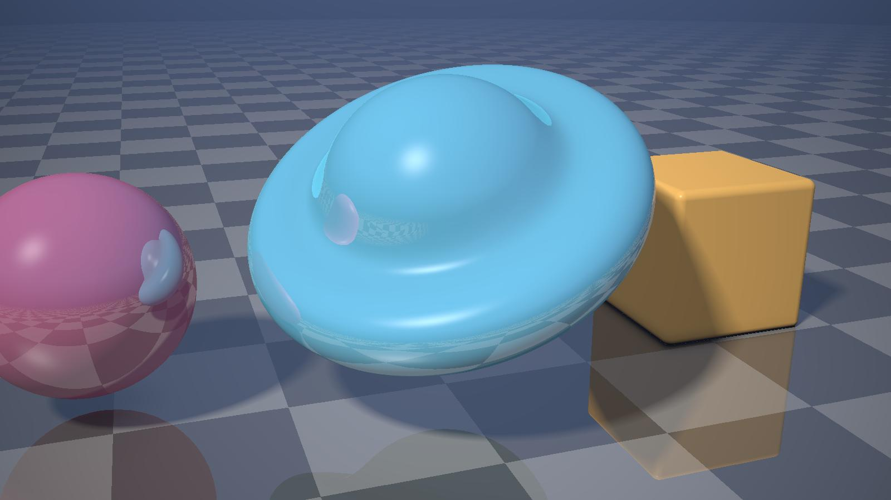
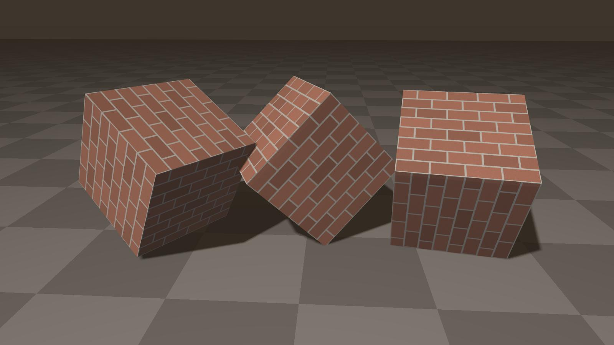
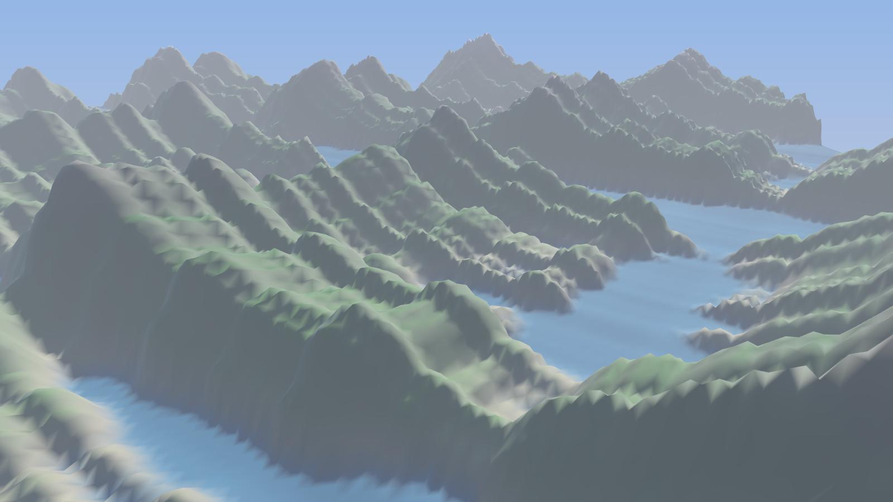
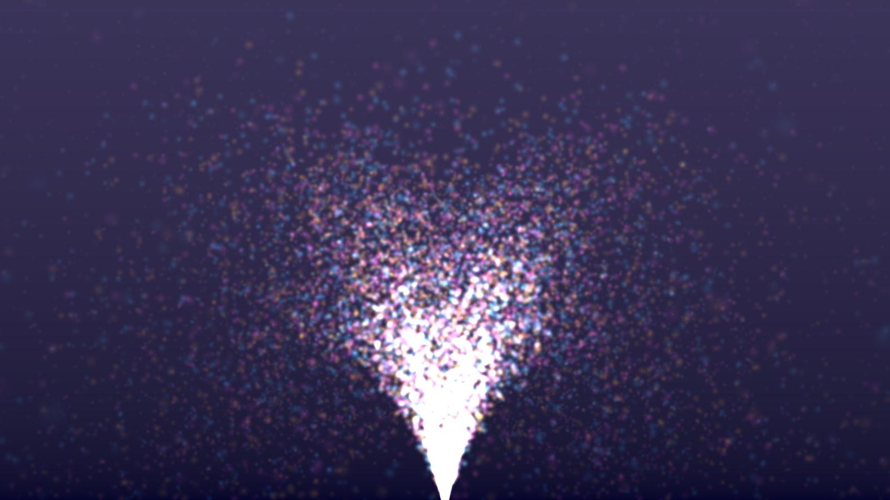

# OpenGL 3.3 + GLSL sample scenes

Five small real-time scenes written against the OpenGL 3.3 core profile. Each one
covers a technique that comes up again and again in graphics projects. Python and
[moderngl](https://github.com/moderngl/moderngl) handle the window-less context and
buffers. All rendering happens in the GLSL shaders, so the shader code ports
directly to a C or CPP + GLFW project.

| | |
|---|---|
|  |  |
| **Shadow mapping**: depth pass from the light, Blinn-Phong lighting, 5x5 PCF soft shadows, 8x MSAA | **Raymarching**: a whole scene in one fragment shader, built from signed distance fields, with soft shadows, ambient occlusion and one reflection bounce |
|  |  |
| **Texture mapping**: procedural brick texture, mipmaps, anisotropic filtering | **Procedural terrain**: 260x260 heightmap mesh, height and slope colouring, exponential fog |
|  | |
| **Particles**: 22,000 point sprites with additive blending | |

## Run

```sh
pip install -r requirements.txt
python scenes.py        # writes renders/*.jpg
```

You need a GPU and driver with OpenGL 3.3 or newer. Inside your own code, use
`render(scene, t, width, height)`, which returns an RGB frame for time `t`. It's handy for
making videos.

## Where to look

- `LIT_VS` / `LIT_FS`: the lighting shader, with Blinn-Phong, shadow lookup with PCF, fog and gamma correction
- `DEPTH_VS`: the shadow-map depth pass
- `RAY_FS`: the raymarcher: `map()` describes the scene, `march()` finds the hit, `softShadow()` and `ao()` add the shading
- `terrain()`: building the heightmap mesh and its normals on the CPU

## Two bugs I hit while building this

- **Shadows repeating across the floor.** Shadow-map lookups outside 0..1 wrapped around and
  drew copies of the shadows far away. The fix is to treat anything outside the light's view as lit.
- **A hard band at the horizon.** Fog used `exp(-(d*k)^2)`, which ramps up too sharply. Plain
  exponential fog, together with a background that matches the fog colour, hides the edge.

## About

Written by Ahsan (Code Projects on YouTube).
I build and debug operating-systems, graphics and desktop projects. Issues and pull requests are welcome.

Licensed under the MIT License.
